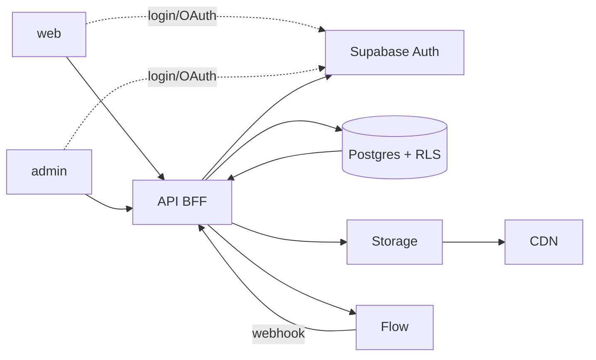
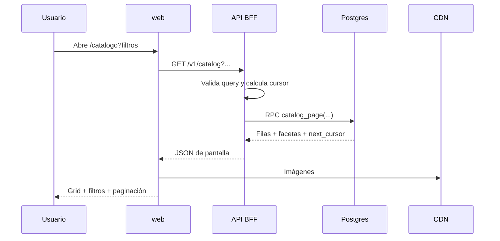
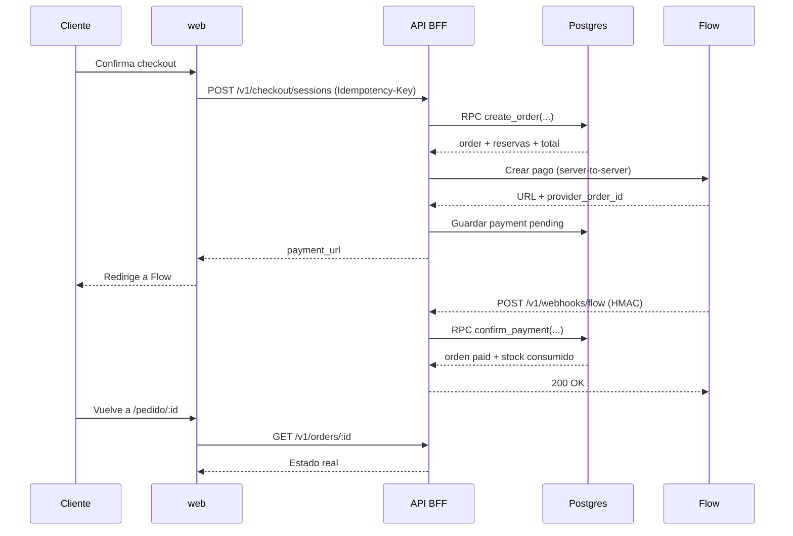
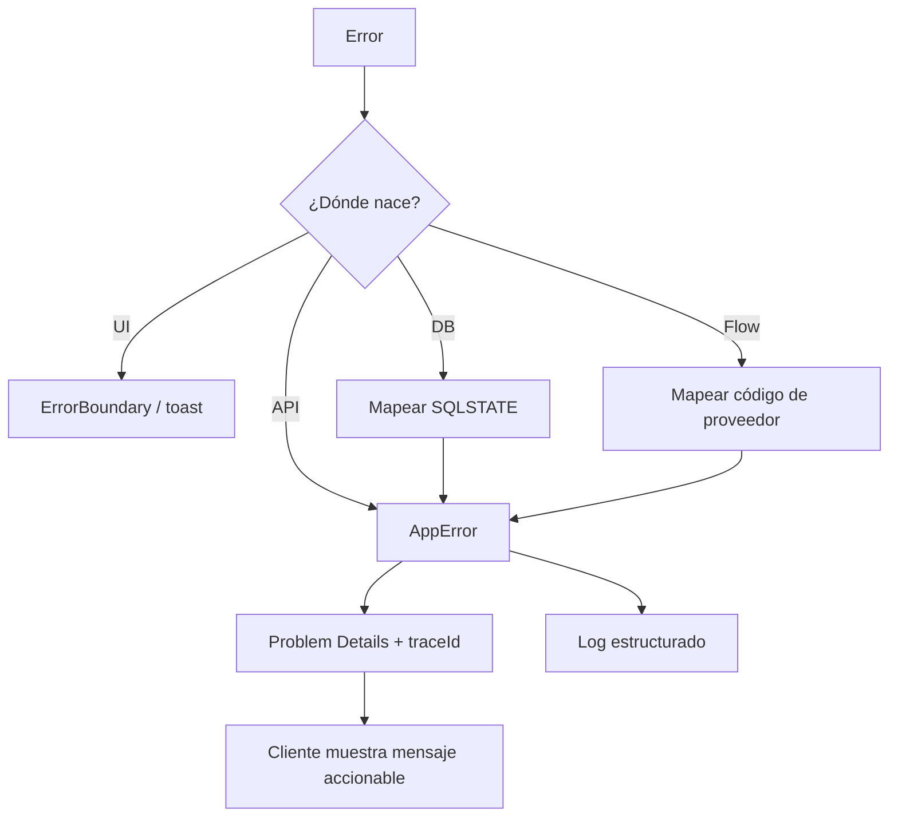

<!-- @pca:start
@id(docs.arquitectura)
@kind(doc)
@relates(docs.modelo_datos)
@relates(docs.reglas_backend)
@relates(docs.reglas_ui)
@relates(docs.estado_proyecto)
@desc(Arquitectura, componentes, contratos, flujos, ADRs, riesgos y pruebas)
@pca:end -->
# Arquitectura

> **Instrucción para la IA:** Este documento responde **cómo se conecta** el sistema. Antes de cambiar un contrato, revisa el flujo afectado y el ticket asociado. No implementes sin `AUTORIZO IMPLEMENTACIÓN`.

> **Estado:** Borrador para G3. La topología elegida es BFF en Edge Functions + PostgREST/RPC; revisable si OPEN-01/OPEN-02 cambian el alcance.

---

## 1. Contexto

**Enchanted Botanicals** tiene dos aplicaciones React y un backend server-to-server:

```text
Navegador
  ├── web (público + cliente)
  └── admin (backoffice)
        │
        ▼
API BFF (Supabase Edge Functions)
  ├── Supabase Auth
  ├── PostgREST / RPC
  ├── Supabase Storage
  └── Flow API
        │
        ▼
PostgreSQL + RLS
```

**Regla de comunicación:** el navegador solo llama a la API BFF. La API habla con Supabase y Flow. La única excepción es Supabase Auth para login/OAuth, porque el SDK necesita gestionar la sesión en el cliente.



---

## 2. Stack y justificación

| Capa | Elección | Por qué |
| :--- | :--- | :--- |
| Monorepo | pnpm workspaces + Turborepo | Compartir UI, contratos y configuración con caché |
| Frontend | React + Vite + TypeScript estricto | SPA rápida, ecosistema y tipado |
| UI | Tailwind + CVA + Radix | Tokens, variantes y accesibilidad |
| Backend | Supabase Edge Functions + Hono | BFF sin servidor propio; secretos seguros |
| Datos | Postgres + RLS + RPC | Integridad, atomicidad y permisos por fila |
| Auth | Supabase Auth | Email/contraseña y OAuth con poca infraestructura |
| Archivos | Supabase Storage + CDN | Imágenes optimizadas y servidas cerca |
| Pagos | Flow server-to-server | El navegador nunca ve secretos |
| Jobs | `pg_cron` + `pg_net` | Expirar reservas, refrescar vistas, reintentos |
| Testing | Vitest, RTL, MSW, Playwright | Unidad, integración, contrato y E2E |
| Deploy | Vercel/Cloudflare + Supabase | Preview por rama y backend gestionado |

---

## 3. Componentes

| Componente | Responsabilidad | Límites |
| :--- | :--- | :--- |
| `apps/web` | Landing, catálogo, cuenta, carrito, checkout, journal | No accede a DB; no conoce secretos |
| `apps/admin` | Dashboard, productos, inventario, pedidos, contenido | No accede a DB; roles verificados en API |
| `packages/ui` | Componentes presentacionales con CVA | Sin llamadas API ni reglas de negocio |
| `packages/tokens` | Variables CSS y tema Tailwind | Sin componentes |
| `packages/domain` | Tipos, reglas puras y máquinas de estado | Sin React ni Supabase |
| `packages/contracts` | Zod/OpenAPI de requests y responses | Fuente de verdad de contratos |
| `packages/api-client` | Cliente tipado del BFF | Sin lógica de UI |
| `packages/supabase` | Tipos generados y helpers de servidor | No se importa en el navegador si contiene secretos |
| `packages/flow` | Cliente y mapeo de estados de Flow | Solo servidor |
| `packages/errors` | `AppError`, códigos y Problem Details | Sin dependencias de framework |
| `packages/config` | ESLint, TS, Tailwind, Vitest | Configuración compartida |
| `api` (Edge) | Router BFF, auth, validación, composición | No contiene reglas de UI |
| `flow-webhook` (Edge) | Verificación HMAC, idempotencia y actualización | Sin JWT; firma obligatoria |
| Postgres | Datos, RLS, RPC, vistas, jobs | No llama a Flow |
| Storage | Imágenes de productos y journal | Políticas por bucket |
| Flow | Checkout y confirmación de pago | Fuente de verdad del pago |

---

## 4. Estructura del monorepo

```text
/
├── apps/
│   ├── web/
│   │   ├── src/
│   │   │   ├── app/            # router, providers, layouts
│   │   │   ├── features/       # catalog, cart, checkout, account, journal
│   │   │   ├── components/     # composición de pantalla
│   │   │   └── lib/            # api-client, query keys, utils
│   │   └── public/
│   └── admin/
│       └── src/
│           ├── app/
│           ├── features/       # dashboard, products, orders, content
│           ├── components/
│           └── lib/
├── packages/
│   ├── ui/
│   ├── tokens/
│   ├── domain/
│   ├── contracts/
│   ├── api-client/
│   ├── supabase/
│   ├── flow/
│   ├── errors/
│   └── config/
├── supabase/
│   ├── migrations/
│   ├── functions/
│   │   ├── api/
│   │   └── flow-webhook/
│   └── seed.sql
├── docs/
├── tools/
├── package.json
├── pnpm-workspace.yaml
└── turbo.json
```

**Regla de dependencias:** `apps` pueden depender de `packages`; `packages/ui` no depende de `features`; `packages/domain` no depende de React ni Supabase; `packages/flow` y secretos solo se importan en Edge.

---

## 5. Flujos principales

### 5.1 Lectura de catálogo



**Presupuesto:** una llamada del cliente, una RPC, cero llamadas externas.

### 5.2 Checkout y Flow



**Reglas:**
- El retorno del navegador no confirma el pago.
- El webhook es idempotente y valida firma.
- La orden se crea con snapshot y reserva atómica.
- Un job libera reservas expiradas.

### 5.3 Error handling



**Contrato de error:** `application/problem+json` con `type`, `title`, `status`, `detail`, `code`, `traceId`, `errors[]`.

---

## 6. Contratos del BFF

| Método | Ruta | Auth | Entrada | Salida | Errores |
| :--- | :--- | :--- | :--- | :--- | :--- |
| GET | `/v1/home` | Público | — | Hero, destacados, colecciones, journal | 500 |
| GET | `/v1/catalog` | Público | `q`, `category`, `light`, `water`, `magic`, `sort`, `cursor`, `limit` | `items`, `facets`, `nextCursor` | 400, 500 |
| GET | `/v1/catalog/:slug` | Público | slug | Producto + imágenes + relacionados | 404, 500 |
| POST | `/v1/auth/sync` | JWT | — | Perfil + roles | 401, 500 |
| GET | `/v1/me/overview` | JWT | — | Perfil, pedidos recientes, wishlist, plantas | 401, 500 |
| GET | `/v1/orders` | JWT | cursor | Pedidos del usuario | 401, 500 |
| GET | `/v1/orders/:id` | JWT | id | Pedido + items + pago + envío | 401, 403, 404 |
| POST | `/v1/checkout/sessions` | JWT | items, addressId, Idempotency-Key | `orderId`, `paymentUrl` | 400, 401, 409, 422, 502 |
| POST | `/v1/webhooks/flow` | HMAC | payload Flow | 200 / 4xx | 400, 401, 409, 500 |
| GET | `/v1/admin/dashboard` | Admin | rango | KPIs + stock bajo + pedidos | 401, 403, 500 |
| GET | `/v1/admin/products` | Admin | cursor, filtros | Productos | 401, 403 |
| POST | `/v1/admin/products` | Admin | producto | Producto creado | 400, 401, 403, 409 |
| PATCH | `/v1/admin/products/:id` | Admin | cambios | Producto | 400, 401, 403, 404, 409 |
| PATCH | `/v1/admin/inventory/:id` | Admin | delta, reason | Stock + movimiento | 400, 401, 403, 409 |
| GET | `/v1/admin/orders` | Admin | cursor, estado | Pedidos | 401, 403 |
| PATCH | `/v1/admin/orders/:id/status` | Admin | estado | Pedido | 400, 401, 403, 404, 409 |
| POST | `/v1/newsletter` | Público | email | Suscripción | 400, 409, 429 |
| POST | `/v1/contact` | Público | formulario | 202 | 400, 429 |

> Los contratos detallados viven en `packages/contracts` y se publican como OpenAPI. Este documento es la vista de arquitectura.

---

## 7. Decisiones de arquitectura (ADRs)

| ID | Decisión | Alternativas | Motivo | Consecuencias |
| :--- | :--- | :--- | :--- | :--- |
| **DEC-01** | Monorepo pnpm + Turborepo | npm workspaces, Nx | Dos apps y paquetes compartidos con caché | Disciplina de dependencias y versiones |
| **DEC-02** | React + Vite + TypeScript estricto | Next.js, Astro | Lo pedido; SPA simple | SEO y SSR se resuelven con metadatos/pre-render |
| **DEC-03** | Tailwind + CVA + tokens | CSS Modules, styled-components | Variantes tipadas y consistencia | Mantener tokens y evitar valores arbitrarios |
| **DEC-04** | Supabase para Auth, DB y Storage | Backend propio | Menos infraestructura y RLS | Dependencia del ecosistema |
| **DEC-05** | BFF Edge + PostgREST/RPC | Node API con Postgres directo | Menos servidores; secretos seguros; server-to-server | Cold starts y límites de Edge |
| **DEC-06** | Flow solo server-to-server | Integración cliente | Seguridad de secretos y firma | Webhooks y conciliación obligatorios |
| **DEC-07** | Error model `AppError` + Problem Details | Mensajes ad hoc | Contrato estable y trazable | Mapear SQLSTATE y Flow |
| **DEC-08** | DB para conjuntos y atomicidad; API para orquestación | Lógica en cliente/API | Menos llamadas y procesos | RPC mantenidas y probadas |
| **DEC-09** | Caché CDN + TanStack Query + vistas materializadas | Sin caché | Latencia y carga | Invalidación correcta |
| **DEC-10** | Guest cart local + merge | Carrito solo auth | Conversión | Complejidad de merge |
| **DEC-11** | Contratos Zod compartidos | Tipos manuales | Una sola verdad | Cambios requieren versionado |
| **DEC-12** | Un solo `api` function + `flow-webhook` | Una function por endpoint | Menos cold starts y despliegues | Router interno disciplinado |
| **DEC-13** | Imágenes en Storage + transformaciones | Assets en repo | Peso y CDN | Políticas de bucket |
| **DEC-14** | `pg_cron` para reservas y vistas | Worker externo | Menos infraestructura | Dependencia de Supabase |

---

## 8. Riesgos

| ID | Riesgo | Prob. | Impacto | Mitigación |
| :--- | :--- | :--- | :--- | :--- |
| **R-01** | Flow no opera en EUR o la moneda no coincide | Alta | Alto | OPEN-01; bloquear checkout hasta definir CLP/EUR |
| **R-02** | Webhook duplicado, perdido o fuera de orden | Media | Alto | `webhook_events`, idempotencia, conciliación y job |
| **R-03** | RLS mal configurada | Media | Alto | Tests de RLS por rol, revisión de políticas |
| **R-04** | SPA con SEO pobre | Media | Medio | Metadatos, prerender de rutas públicas y sitemap |
| **R-05** | Inventario SKU vs espécimen | Alta | Alto | OPEN-02; decidir antes de T06/T20 |
| **R-06** | Cold starts/límites de Edge | Media | Medio | Router único, caché y monitoreo |
| **R-07** | Scope creep por los mockups | Alta | Medio | G1/G2 con fuera de alcance explícito |
| **R-08** | Paleta inconsistente en `DESIGN.md` | Alta | Medio | OPEN-06; tokens canónicos |
| **R-09** | Acoplamiento entre apps y paquetes | Media | Medio | Reglas de dependencias y lint |
| **R-10** | Complejidad de RPC y PostgREST | Media | Medio | Contratos, tests y límites de responsabilidad |

---

## 9. Testing

| Nivel | Herramienta | Qué cubre |
| :--- | :--- | :--- |
| Unidad | Vitest | Reglas de dominio, cálculos, mapeos |
| Componentes | RTL + MSW | Estados de UI, formularios, errores |
| Contratos | Zod + tests de esquema | Requests/responses del BFF |
| Integración | Supabase local | RPC, constraints, RLS |
| RLS | SQL tests | Cada rol ve solo lo permitido |
| E2E | Playwright | Registro → compra → Flow sandbox → pedido |
| Performance | k6 / Lighthouse | p95, payload, Core Web Vitals |
| Accesibilidad | axe | Teclado, contraste, labels |

**Puerta de calidad:** ningún ticket pasa a Hecho sin tests del camino feliz y al menos un edge case.

---

## 10. Despliegue

| Entorno | Frontend | Backend/DB | Pagos |
| :--- | :--- | :--- | :--- |
| Local | Vite dev | Supabase CLI + Edge local | Flow sandbox/mock |
| Staging | Preview por rama | Proyecto Supabase staging | Flow sandbox |
| Producción | Vercel/Cloudflare | Supabase producción | Flow producción |

**Variables:**
- Públicas: `VITE_SUPABASE_URL`, `VITE_SUPABASE_ANON_KEY`, `VITE_API_URL`.
- Servidor: `SUPABASE_SERVICE_ROLE_KEY`, `FLOW_API_KEY`, `FLOW_SECRET_KEY`, `FLOW_WEBHOOK_SECRET`, `FLOW_API_URL`.
- Nunca usar `VITE_*` para secretos.

**CI:** lint + typecheck + tests + migraciones en seco + build. Las migraciones se aplican con revisión y backup.

---

## 11. Preguntas abiertas

| ID | Pregunta | Decisión afectada |
| :--- | :--- | :--- |
| **OPEN-01** | País/moneda de Flow | Checkout, precios, impuestos |
| **OPEN-02** | SKU vs espécimen | Modelo, admin, Mi Invernadero |
| **OPEN-03** | IA real vs FAQ | S6 e integraciones |
| **OPEN-04** | Apple OAuth | Auth |
| **OPEN-05** | Envío/impuestos | Totales y Flow |
| **OPEN-06** | Paleta canónica | Tokens UI |
| **OPEN-07** | Email transaccional | Confirmaciones |
| **OPEN-08** | Roles admin | RLS y admin |
| **OPEN-09** | Tailwind v3.4 vs v4 | Tokens y build |

---

## 12. Historial de cambios

| Fecha | Cambio |
| :--- | :--- |
| 2026-10-22 | Borrador inicial de arquitectura, flujos, contratos, ADRs y riesgos. |
