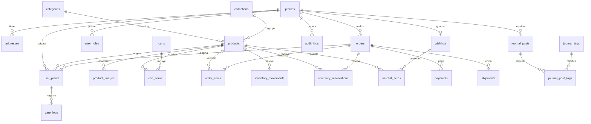

<!-- @pca:start
@id(docs.modelo_datos)
@kind(doc)
@relates(docs.backlog_requisitos)
@relates(docs.arquitectura)
@relates(docs.reglas_backend)
@desc(Modelo de datos, relaciones, integridad, estados y RLS)
@pca:end -->
# Modelo de Datos

> **Instrucción para la IA:** Este documento responde **cómo se guarda** el dominio. Antes de cambiar una entidad, revisa las relaciones y el impacto en `docs/arquitectura.md` y `docs/reglas_backend.md`.

> **Estado:** Borrador para G3. Las decisiones de inventario y moneda dependen de OPEN-01 y OPEN-02.

---

## 1. Principios

1. **Postgres es la fuente de verdad.** El cliente nunca calcula stock, totales ni permisos.
2. **UUID como clave primaria.** Evita colisiones y permite generar IDs antes de insertar.
3. **Dinero en enteros.** `*_cents` + `currency`; nunca `float`.
4. **Snapshots en pedidos.** El historial no cambia si el producto cambia.
5. **Estados explícitos.** Nada de booleanos ambiguos para flujos.
6. **RLS en toda tabla.** El acceso se define por dueño, rol o publicación.
7. **Migraciones forward-only.** No se edita una migración aplicada.
8. **Borrado lógico en catálogo.** `archived_at`; los pedidos históricos se conservan.
9. **JSONB con presupuesto.** Solo para metadatos flexibles, nunca para reemplazar columnas consultables.
10. **Una tabla, una responsabilidad.** Si una entidad tiene dos ciclos de vida, se separa.

---

## 2. Entidades principales

| Entidad | Propósito | Sensible |
| :--- | :--- | :--- |
| `profiles` | Perfil público y de contacto del usuario | Sí |
| `user_roles` | Roles (`customer`, `admin`) | No |
| `addresses` | Direcciones de envío | Sí |
| `categories` | Categorías del catálogo | No |
| `collections` | Colecciones editoriales/comerciales | No |
| `products` | Producto vendible y datos de cuidado | No |
| `product_images` | Imágenes del producto | No |
| `inventory_movements` | Historial de cambios de stock | No |
| `carts` / `cart_items` | Carrito autenticado | No |
| `orders` | Cabecera del pedido y totales | Sí |
| `order_items` | Snapshot de líneas | Sí |
| `payments` | Estado del pago en Flow | Sí |
| `inventory_reservations` | Stock reservado por orden | No |
| `shipments` | Envío y tracking | Sí |
| `wishlists` / `wishlist_items` | Favoritos | Sí |
| `user_plants` | Plantas adoptadas por el cliente | Sí |
| `care_logs` | Bitácora de cuidados | Sí |
| `journal_posts` | Contenido público | No |
| `journal_tags` / `journal_post_tags` | Etiquetas del journal | No |
| `newsletter_subscribers` | Suscriptores | Sí |
| `webhook_events` | Eventos de proveedores e idempotencia | Sí |
| `idempotency_keys` | Repetición segura de escrituras | No |
| `audit_logs` | Auditoría de acciones sensibles | Sí |

---

## 3. Atributos

### 3.1 Identidad y clientes

**`profiles`**

| Columna | Tipo | Reglas |
| :--- | :--- | :--- |
| `id` | `uuid` | PK; FK a `auth.users.id`; `on delete cascade` |
| `full_name` | `text` | Not null, 2–120 caracteres |
| `phone` | `text` | Nullable, E.164 cuando exista |
| `avatar_url` | `text` | Nullable |
| `created_at` | `timestamptz` | Default `now()` |
| `updated_at` | `timestamptz` | Trigger de actualización |

**`user_roles`**

| Columna | Tipo | Reglas |
| :--- | :--- | :--- |
| `user_id` | `uuid` | FK `profiles.id`, `on delete cascade` |
| `role` | `user_role` | Enum `customer`, `admin`; default `customer` |
| `created_at` | `timestamptz` | Default `now()` |
| PK | `(user_id, role)` | Un rol por usuario y tipo |

**`addresses`**

| Columna | Tipo | Reglas |
| :--- | :--- | :--- |
| `id` | `uuid` | PK |
| `user_id` | `uuid` | FK `profiles.id`, `on delete cascade` |
| `label` | `text` | Ej. “Casa”, “Oficina” |
| `recipient_name` | `text` | Not null |
| `phone` | `text` | Not null |
| `line1` | `text` | Not null |
| `line2` | `text` | Nullable |
| `city` | `text` | Not null |
| `region` | `text` | Not null |
| `postal_code` | `text` | Nullable según país |
| `country` | `char(2)` | ISO 3166-1 alpha-2 |
| `is_default` | `boolean` | Default `false` |
| `created_at` / `updated_at` | `timestamptz` | Default `now()` |

> Un índice parcial garantiza como máximo una dirección default por usuario.

### 3.2 Catálogo

**`categories`**

| Columna | Tipo | Reglas |
| :--- | :--- | :--- |
| `id` | `uuid` | PK |
| `name` | `text` | Not null |
| `slug` | `text` | Unique, not null |
| `description` | `text` | Nullable |
| `image_url` | `text` | Nullable |
| `sort_order` | `integer` | Default 0 |
| `is_active` | `boolean` | Default `true` |
| `created_at` / `updated_at` | `timestamptz` | Default `now()` |

**`collections`**: misma forma que `categories`, con `name`, `slug`, `description`, `image_url`, `is_active`, `sort_order`.

**`products`**

| Columna | Tipo | Reglas |
| :--- | :--- | :--- |
| `id` | `uuid` | PK |
| `category_id` | `uuid` | FK `categories.id`, `on delete restrict` |
| `collection_id` | `uuid` | FK `collections.id`, nullable |
| `common_name` | `text` | Not null |
| `scientific_name` | `text` | Not null |
| `slug` | `text` | Unique, not null |
| `description` | `text` | Not null |
| `care_light` | `care_light` | Enum `low`, `medium`, `bright_indirect`, `direct` |
| `care_water` | `care_water` | Enum `low`, `medium`, `high` |
| `care_humidity` | `care_humidity` | Enum `low`, `medium`, `high` |
| `climate` | `text` | Ej. tropical, templado |
| `magic_level` | `smallint` | 1–4 (I–IV) |
| `price_cents` | `integer` | `>= 0` |
| `currency` | `char(3)` | ISO 4217; una por entorno |
| `stock` | `integer` | `>= 0` |
| `low_stock_threshold` | `integer` | Default 3 |
| `is_active` | `boolean` | Default `true` |
| `is_featured` | `boolean` | Default `false` |
| `metadata` | `jsonb` | Default `{}`; solo datos no consultables |
| `search_vector` | `tsvector` | Generado desde nombre, científico y descripción |
| `created_at` / `updated_at` | `timestamptz` | Default `now()` |
| `archived_at` | `timestamptz` | Nullable; borrado lógico |

**`product_images`**

| Columna | Tipo | Reglas |
| :--- | :--- | :--- |
| `id` | `uuid` | PK |
| `product_id` | `uuid` | FK `products.id`, `on delete cascade` |
| `storage_path` | `text` | Ruta en Supabase Storage |
| `alt` | `text` | Not null para accesibilidad |
| `sort_order` | `integer` | Default 0 |
| `created_at` | `timestamptz` | Default `now()` |

**`inventory_movements`**

| Columna | Tipo | Reglas |
| :--- | :--- | :--- |
| `id` | `uuid` | PK |
| `product_id` | `uuid` | FK `products.id`, `on delete restrict` |
| `delta` | `integer` | Distinto de 0 |
| `reason` | `inventory_reason` | `sale`, `restock`, `adjustment`, `reservation_release` |
| `order_id` | `uuid` | FK `orders.id`, nullable |
| `created_by` | `uuid` | FK `profiles.id`, nullable para jobs |
| `created_at` | `timestamptz` | Default `now()` |

### 3.3 Carrito y pedidos

**`carts`**

| Columna | Tipo | Reglas |
| :--- | :--- | :--- |
| `id` | `uuid` | PK |
| `user_id` | `uuid` | FK `profiles.id`, unique; un carrito activo por usuario |
| `status` | `cart_status` | `active`, `converted`, `abandoned` |
| `created_at` / `updated_at` | `timestamptz` | Default `now()` |

**`cart_items`**

| Columna | Tipo | Reglas |
| :--- | :--- | :--- |
| `id` | `uuid` | PK |
| `cart_id` | `uuid` | FK `carts.id`, `on delete cascade` |
| `product_id` | `uuid` | FK `products.id`, `on delete restrict` |
| `quantity` | `integer` | `> 0` y `<= 20` |
| `created_at` / `updated_at` | `timestamptz` | Default `now()` |
| Unique | `(cart_id, product_id)` | Evita duplicados |

**`orders`**

| Columna | Tipo | Reglas |
| :--- | :--- | :--- |
| `id` | `uuid` | PK |
| `user_id` | `uuid` | FK `profiles.id`, `on delete restrict` |
| `status` | `order_status` | Ver estados |
| `payment_status` | `payment_status` | Ver estados |
| `subtotal_cents` | `integer` | `>= 0` |
| `shipping_cents` | `integer` | `>= 0` |
| `tax_cents` | `integer` | `>= 0` |
| `total_cents` | `integer` | `= subtotal + shipping + tax` |
| `currency` | `char(3)` | Debe coincidir con productos |
| `shipping_address` | `jsonb` | Snapshot de dirección; PII |
| `notes` | `text` | Nullable |
| `created_at` / `updated_at` | `timestamptz` | Default `now()` |
| `paid_at` / `cancelled_at` | `timestamptz` | Nullable |

**`order_items`**

| Columna | Tipo | Reglas |
| :--- | :--- | :--- |
| `id` | `uuid` | PK |
| `order_id` | `uuid` | FK `orders.id`, `on delete cascade` |
| `product_id` | `uuid` | FK `products.id`, `on delete restrict` |
| `product_name` | `text` | Snapshot |
| `scientific_name` | `text` | Snapshot |
| `unit_price_cents` | `integer` | Snapshot |
| `quantity` | `integer` | `> 0` |
| `line_total_cents` | `integer` | `unit_price * quantity` |

**`payments`**

| Columna | Tipo | Reglas |
| :--- | :--- | :--- |
| `id` | `uuid` | PK |
| `order_id` | `uuid` | FK `orders.id`, `on delete restrict` |
| `provider` | `text` | `flow` por ahora |
| `provider_order_id` | `text` | Unique por proveedor |
| `provider_payment_id` | `text` | Nullable hasta confirmación |
| `status` | `payment_status` | `pending`, `paid`, `rejected`, `cancelled`, `refunded` |
| `amount_cents` | `integer` | Debe igualar `orders.total_cents` |
| `currency` | `char(3)` | Debe coincidir con la orden |
| `raw_status` | `text` | Último estado recibido |
| `last_synced_at` | `timestamptz` | Nullable |
| `created_at` / `updated_at` | `timestamptz` | Default `now()` |
| `paid_at` | `timestamptz` | Nullable |

**`inventory_reservations`**

| Columna | Tipo | Reglas |
| :--- | :--- | :--- |
| `id` | `uuid` | PK |
| `order_id` | `uuid` | FK `orders.id`, `on delete cascade` |
| `product_id` | `uuid` | FK `products.id`, `on delete restrict` |
| `quantity` | `integer` | `> 0` |
| `status` | `reservation_status` | `active`, `consumed`, `expired`, `released` |
| `expires_at` | `timestamptz` | Default `now() + 15 min` |
| Unique | `(order_id, product_id)` | Una reserva activa por línea |

**`shipments`**

| Columna | Tipo | Reglas |
| :--- | :--- | :--- |
| `id` | `uuid` | PK |
| `order_id` | `uuid` | FK `orders.id`, `on delete cascade` |
| `carrier` | `text` | Nullable |
| `tracking_number` | `text` | Nullable |
| `status` | `shipment_status` | `pending`, `shipped`, `delivered`, `returned` |
| `shipped_at` / `delivered_at` | `timestamptz` | Nullable |

### 3.4 Cuenta y pertenencia

**`wishlists`**: `id`, `user_id` (unique, FK profiles), `created_at`.
**`wishlist_items`**: `id`, `wishlist_id`, `product_id`, `created_at`, unique `(wishlist_id, product_id)`.

**`user_plants`**

| Columna | Tipo | Reglas |
| :--- | :--- | :--- |
| `id` | `uuid` | PK |
| `user_id` | `uuid` | FK `profiles.id`, `on delete cascade` |
| `product_id` | `uuid` | FK `products.id`, `on delete restrict` |
| `order_id` | `uuid` | FK `orders.id`, `on delete restrict` |
| `nickname` | `text` | Nullable |
| `acquired_at` | `date` | Default `current_date` |
| `care_light` | `care_light` | Snapshot |
| `care_water` | `care_water` | Snapshot |
| `notes` | `text` | Nullable |
| `created_at` / `updated_at` | `timestamptz` | Default `now()` |

**`care_logs`**

| Columna | Tipo | Reglas |
| :--- | :--- | :--- |
| `id` | `uuid` | PK |
| `user_plant_id` | `uuid` | FK `user_plants.id`, `on delete cascade` |
| `type` | `care_type` | `water`, `light`, `prune`, `fertilize`, `note` |
| `notes` | `text` | Nullable |
| `performed_at` | `timestamptz` | Not null |
| `next_due_at` | `timestamptz` | Nullable |
| `created_at` | `timestamptz` | Default `now()` |

### 3.5 Contenido y operación

**`journal_posts`**: `id`, `author_id` (FK profiles), `title`, `slug` unique, `excerpt`, `content`, `cover_url`, `status` (`draft`, `published`, `archived`), `published_at`, `created_at`, `updated_at`.

**`journal_tags`**: `id`, `name`, `slug` unique.
**`journal_post_tags`**: `post_id`, `tag_id`, PK compuesta.

**`newsletter_subscribers`**: `id`, `email` (`citext` unique), `status` (`pending`, `confirmed`, `unsubscribed`), `confirmed_at`, `created_at`.

**`webhook_events`**: `id`, `provider`, `event_id`, `event_type`, `payload` (jsonb), `status` (`received`, `processed`, `failed`, `ignored`), `processed_at`, `created_at`, unique `(provider, event_id)`.

**`idempotency_keys`**: `key` (text), `endpoint`, `user_id`, `request_hash`, `response_status`, `response_body` (jsonb), `created_at`, `expires_at`, PK `(key, endpoint)`.

**`audit_logs`**: `id`, `actor_id`, `action`, `entity`, `entity_id`, `before` (jsonb), `after` (jsonb), `created_at`; append-only.

---

## 4. Relaciones



---

## 5. Estados

### 5.1 Orden

```text
pending_payment → paid → preparing → shipped → delivered
pending_payment → cancelled
pending_payment → expired
paid → refunded
```

| Estado | Significado | Permitido desde |
| :--- | :--- | :--- |
| `pending_payment` | Orden creada, esperando Flow | creación |
| `paid` | Pago confirmado por webhook | `pending_payment` |
| `preparing` | Admin prepara el pedido | `paid` |
| `shipped` | Enviado con tracking | `preparing` |
| `delivered` | Entregado | `shipped` |
| `cancelled` | Cancelado antes de pagar | `pending_payment` |
| `expired` | Reserva expirada | `pending_payment` |
| `refunded` | Reembolsado | `paid` |

### 5.2 Pago

`pending → paid | rejected | cancelled`; `paid → refunded`.

### 5.3 Reserva

`active → consumed | expired | released`.

### 5.4 Envío

`pending → shipped → delivered`; `shipped → returned`.

> Las transiciones se validan en la RPC o en el API, no solo en la UI. Un estado inválido responde 409.

---

## 6. Integridad y reglas de base de datos

| ID | Regla |
| :--- | :--- |
| **DB-01** | Toda tabla de usuario tiene `user_id` o se deriva de una relación con dueño. |
| **DB-02** | Las FK llevan índice; las FK de pedidos e inventario usan `on delete restrict`. |
| **DB-03** | `products.stock >= 0`, `order_items.quantity > 0`, `price_cents >= 0`. |
| **DB-04** | `orders.total_cents = subtotal_cents + shipping_cents + tax_cents`. |
| **DB-05** | `payments.amount_cents = orders.total_cents` y misma moneda. |
| **DB-06** | No se puede consumir una reserva dos veces. |
| **DB-07** | Un pedido pagado no se borra; se reembolsa o se cancela con auditoría. |
| **DB-08** | Un producto archivado no se vende, pero su histórico permanece. |
| **DB-09** | `webhook_events` es único por `(provider, event_id)`. |
| **DB-10** | `audit_logs` es append-only; no se actualiza ni se borra desde la app. |
| **DB-11** | Los slugs son únicos por tabla y estables. |
| **DB-12** | Los timestamps son `timestamptz`; nunca `timestamp` sin zona. |

---

## 7. RLS y seguridad

| Tabla | Política base |
| :--- | :--- |
| `profiles` | El usuario lee/edita su perfil; admin lee todos. |
| `addresses` | Dueño CRUD; admin lee para envíos. |
| `orders` / `order_items` | Dueño lee sus pedidos; admin lee todos. |
| `payments` | Dueño lee estado; admin lee todos; escritura solo servidor. |
| `carts` / `cart_items` | Dueño CRUD; admin no necesita acceso. |
| `wishlists` / `wishlist_items` | Dueño CRUD. |
| `user_plants` / `care_logs` | Dueño CRUD. |
| `products` / `product_images` / `categories` / `collections` | Lectura pública si activo; escritura solo admin. |
| `journal_posts` | Lectura pública si `published`; escritura admin. |
| `newsletter_subscribers` | Inserción pública limitada; lectura admin. |
| `webhook_events` / `idempotency_keys` / `audit_logs` | Solo `service_role`; nunca cliente. |

> `service_role` omite RLS. Solo se usa en Edge Functions y jobs; nunca en variables `VITE_*`.

---

## 8. Datos sensibles y retención

| Dato | Dónde vive | Protección | Retención propuesta |
| :--- | :--- | :--- | :--- |
| Nombre, email, teléfono | `profiles`, `orders.shipping_address` | RLS, TLS, logs sin PII | Mientras la cuenta exista |
| Dirección | `addresses`, snapshot de orden | RLS, acceso admin restringido | Cuenta + obligación legal |
| Historial de pedidos | `orders`, `order_items` | RLS | 6 años o política legal |
| IDs de Flow | `payments`, `webhook_events` | Solo servidor | 2 años |
| Contenido de webhook | `webhook_events.payload` | Solo servidor; minimizar | 90 días |
| Datos de tarjeta | **No se almacenan** | — | — |

> La retención exacta se aprueba en G3 con la normativa aplicable (OPEN-01).

---

## 9. Consultas y rendimiento

| Necesidad | Estrategia |
| :--- | :--- |
| Catálogo con filtros | Índices en `is_active`, `category_id`, `collection_id`, `price_cents`, `magic_level`; `search_vector` GIN. |
| Búsqueda | `websearch_to_tsquery` + ranking; fallback `ILIKE` para pocos datos. |
| Detalle | Índice único en `slug`; imágenes por `product_id, sort_order`. |
| Dashboard | Vista materializada `admin_dashboard_daily` refrescada por job. |
| Pedidos del cliente | Índice `(user_id, created_at desc)`. |
| Stock bajo | Índice parcial `stock <= low_stock_threshold`. |
| Webhooks | Unique `(provider, event_id)`. |
| Idempotencia | PK `(key, endpoint)` con expiración. |
| Journal | Índice `(status, published_at desc)` y tags. |

> Las consultas de lista usan cursor (`created_at`, `id`), no `offset` grande.

---

## 10. Decisiones

| ID | Decisión | Motivo |
| :--- | :--- | :--- |
| DEC-DATA-01 | UUID en todas las PK | IDs no predecibles y generables en cliente/servidor |
| DEC-DATA-02 | Dinero en centavos + moneda | Evita errores de punto flotante |
| DEC-DATA-03 | Snapshot en `order_items` | El historial no cambia con el catálogo |
| DEC-DATA-04 | Reservas de stock separadas | Permite expirar y liberar sin borrar órdenes |
| DEC-DATA-05 | Borrado lógico de productos | Conserva referencias históricas |
| DEC-DATA-06 | Roles en tabla | Un usuario puede tener más de un rol |
| DEC-DATA-07 | JSONB limitado | Flexibilidad sin perder integridad |
| DEC-DATA-08 | `search_vector` generado | Búsqueda rápida y consistente |
| DEC-DATA-09 | `webhook_events` como bandeja | Idempotencia y auditoría de Flow |
| DEC-DATA-10 | `audit_logs` append-only | Investigación de incidentes |

---

## 11. Preguntas abiertas

| ID | Pregunta | Impacto |
| :--- | :--- | :--- |
| **OPEN-01** | Moneda/país de Flow | `currency`, impuestos y totales |
| **OPEN-02** | ¿SKU o espécimen único? | `products.stock` vs una fila por planta |
| **OPEN-05** | Reglas de envío e impuestos | `shipping_cents`, `tax_cents` |
| **OPEN-06** | Paleta canónica | No afecta datos, pero sí consistencia de marca |
| **OPEN-08** | Roles admin granulares | `user_roles` y políticas RLS |

---

## 12. Historial de cambios

| Fecha | Cambio |
| :--- | :--- |
| 2026-10-22 | Borrador inicial del modelo, relaciones, estados y RLS. |
